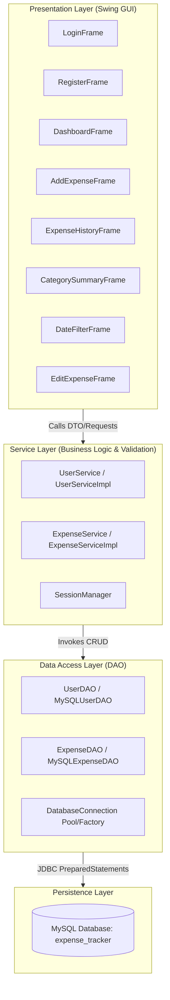
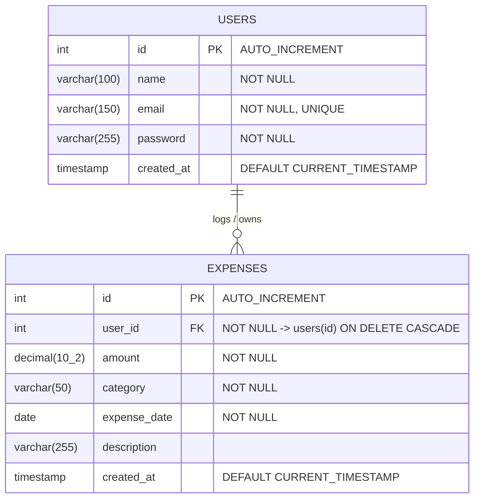

# Expense Tracker System (Java Swing & MySQL)

---

## 1. Project Title
**Personal Expense Tracker — Desktop Financial Management System**

---

## 2. Project Information

| Field | Details |
| :--- | :--- |
| **Project Title** | Personal Expense Tracker |
| **Student Name** | *[Insert Student Name]* |
| **Roll Number / Student ID** | *[Insert Roll / ID Number]* |
| **Course / Degree** | *[e.g., B.Tech Computer Science / MCA / BCA]* |
| **Department** | *[Insert Department Name]* |
| **Institution / University** | *[Insert College / University Name]* |
| **Academic Year / Semester** | *[e.g., 2025–2026 / Semester VI]* |
| **Project Guide / Supervisor** | *[Insert Guide / Mentor Name]* |
| **Submission Date** | *[Insert Submission Date]* |

---

## 3. Problem Statement
Managing personal daily finances manually using paper notebooks, spreadsheets, or ad-hoc notes is error-prone, inefficient, and lacks automated analysis. Individuals often struggle with:
- **Lack of Centralized Tracking:** Expenses are scattered across receipts, cards, and cash transactions without a unified record.
- **Absence of Real-Time Analytics:** Difficulty in determining monthly spending trends, category distributions, or budget overshoots in real time.
- **Data Inconsistency & Security Risks:** Unstructured files can easily be misplaced, modified without validation, or viewed by unauthorized parties.
- **Inefficient Filtering & Retrieval:** Searching through historical entries across custom date intervals or categories is tedious without structured relational queries.

**Expense Tracker** provides an intuitive desktop solution that ensures strict data validation, secure multi-user data isolation, asynchronous performance, and real-time analytical summaries.

---

## 4. Objectives
- **Automate Expense Management:** Allow users to record, update, view, and delete daily expenses seamlessly.
- **Enforce Robust Data Validation:** Prevent invalid amounts (negative/zero), corrupt date ranges, blank fields, and malformed emails at the presentation and service layers.
- **Implement Strict Multi-User Security:** Guarantee complete data isolation so that each authenticated user can only access their own records.
- **Provide Visual Analytics:** Generate instant financial metrics, including total expenditure, transaction count, current month totals, and category-wise aggregations.
- **Demonstrate Core Software Engineering Principles:** Implement clean Layered Architecture (MVC/Service-DAO pattern), complete Object-Oriented Programming (OOP), and multithreaded concurrency.

---

## 5. Features
- **User Authentication & Session Management:**
  - Secure user registration with email format validation and duplicate checks.
  - User login verification using parameterized SQL queries.
  - In-memory `SessionManager` managing authenticated user context and sanitized state.
- **Dashboard & Financial Summary:**
  - Dynamic KPI cards displaying **Total Expenses**, **Total Transactions**, and **Current Month Expenses**.
  - Asynchronous background calculation avoiding UI freezing.
- **Expense Recording & Management:**
  - Add expenses with custom amount, category (Food, Rent, Utilities, Transport, Entertainment, Health, Shopping, Education, Other), date picker/input, and description.
  - Full CRUD operations: View, Edit, and Delete with user confirmation dialogs.
- **Analytics & Category Breakdown:**
  - Visual summary displaying total spend, percentage share, and transaction frequency per category.
- **Date-Range Filtering:**
  - Filter transactions across custom Start and End dates with strict temporal validation (Start Date $\le$ End Date).
- **Modern Swing UI/UX:**
  - Cohesive Dark Blue / Modern Slate theme (`UITheme.java`).
  - Asynchronous loading spinners (`JProgressBar`) for database-bound tasks.
  - Centered dialogs, padded forms, responsive layouts, and auto-formatted currency strings.

---

## 6. Technologies Used

| Layer / Aspect | Technology / Tool |
| :--- | :--- |
| **Programming Language** | Java (JDK 17 or higher / Tested on OpenJDK 21 & 27) |
| **Graphical User Interface** | Java Swing & AWT (Event Dispatch Thread compliant) |
| **Database Management System** | MySQL Server 8.0+ |
| **Database Connectivity** | JDBC (Java Database Connectivity) API |
| **JDBC Driver** | MySQL Connector/J `mysql-connector-j-8.3.0.jar` |
| **Concurrency / Multitasking**| `javax.swing.SwingWorker`, `java.util.concurrent.CompletableFuture` |
| **Architecture** | 4-Tier Layered Architecture (Presentation $\rightarrow$ Service $\rightarrow$ DAO $\rightarrow$ Database) |
| **Design Paradigm** | Object-Oriented Programming (OOP) & SOLID Principles |

---

## 7. System Requirements

### Hardware Requirements
- **Processor:** Intel Core i3 / AMD Ryzen 3 or higher.
- **RAM:** Minimum 2 GB RAM (4 GB recommended).
- **Disk Space:** Minimum 200 MB free hard drive space.
- **Display Resolution:** Minimum $1024 \times 768$ screen resolution.

### Software Requirements
- **Operating System:** Windows 10/11, macOS, or Linux.
- **Java Development Kit (JDK):** JDK 17, 21, or newer.
- **Database Server:** MySQL Server 8.0 or MySQL Community Server.
- **Command Line / Terminal:** PowerShell, Command Prompt, or Bash.
- **IDE (Optional):** IntelliJ IDEA, Eclipse, NetBeans, or VS Code with Java extensions.

---

## 8. Project Architecture

The project adheres to a **4-Tier Layered Architecture**, ensuring strict separation of concerns, high maintainability, and testability.



### Layer Descriptions
1. **Presentation Layer (`ui` package):** Swing GUI components handling user interactions, form presentation, and Event Dispatch Thread (EDT) updates.
2. **Service Layer (`service` package):** Enforces business rules, input sanitization, logical validation (e.g. preventing negative amounts, date ordering), and transaction coordination.
3. **Data Access Layer (`dao` package):** Manages SQL queries, PreparedStatement execution, ResultSet mapping, and database connection lifecycles.
4. **Model Layer (`model` package):** Strongly-typed Domain entities representing core domain data (`User`, `RegularUser`, `AdminUser`, `Expense`, `BaseEntity`).

---

## 9. Database Structure

### Database Schema: `expense_tracker`



### Table Definitions

#### 1. `users` Table
Stores registered application users.

| Column | Data Type | Constraints | Description |
| :--- | :--- | :--- | :--- |
| `id` | `INT` | Primary Key, Auto Increment | Unique user identifier |
| `name` | `VARCHAR(100)` | `NOT NULL` | Full name of the user |
| `email` | `VARCHAR(150)` | `NOT NULL`, `UNIQUE` | User login email address |
| `password` | `VARCHAR(255)` | `NOT NULL` | User password |
| `created_at` | `TIMESTAMP` | `DEFAULT CURRENT_TIMESTAMP`| Account creation timestamp |

#### 2. `expenses` Table
Stores financial records isolated by `user_id`.

| Column | Data Type | Constraints | Description |
| :--- | :--- | :--- | :--- |
| `id` | `INT` | Primary Key, Auto Increment | Unique expense record ID |
| `user_id` | `INT` | `NOT NULL`, Foreign Key | References `users(id)` with `ON DELETE CASCADE` |
| `amount` | `DECIMAL(10, 2)` | `NOT NULL` | Expense monetary amount ($> 0.00$) |
| `category` | `VARCHAR(50)` | `NOT NULL` | Category tag (Food, Rent, etc.) |
| `expense_date`| `DATE` | `NOT NULL` | Date when expense occurred |
| `description` | `VARCHAR(255)` | Nullable | Optional notes / transaction description |
| `created_at` | `TIMESTAMP` | `DEFAULT CURRENT_TIMESTAMP`| Record timestamp |

---

## 10. Object-Oriented Programming (OOP) Concepts

The codebase strictly adheres to all core OOP principles:

### 1. Encapsulation
- All entity fields in `BaseEntity`, `User`, and `Expense` are declared `private`.
- Access and modification are mediated exclusively through validated public getters and setters (e.g. checking for nulls or non-negative numbers).
- Sensitive fields like passwords are scrubbed in string representations (`User.toString()` prints `password='[PROTECTED]'`).

### 2. Inheritance
- `BaseEntity.java` acts as the root class encapsulating common database entity properties (`id`, `createdAt`).
- `User.java` and `Expense.java` extend `BaseEntity`.
- `RegularUser.java` and `AdminUser.java` inherit from `User.java`, reusing foundational identity attributes while specializing user behavior.

### 3. Polymorphism
- **Dynamic Method Overriding:** `User.java` defines abstract methods `getRole()` and `getRoleDescription()`, which are polymorphically implemented by `RegularUser` (returning `"Standard User"`) and `AdminUser` (returning `"System Administrator"`).
- **Interface Polymorphism:** Service and UI layers depend on interface types (`UserService`, `ExpenseService`, `UserDAO`, `ExpenseDAO`) rather than concrete database implementations.

### 4. Abstraction
- Abstract classes `BaseEntity` and `User` hide internal state management.
- Complex database connectivity, connection pooling, and SQL transactions are abstracted away behind simple DAO method contracts (`findById`, `findByUser`, `getCategorySummary`).

### 5. Interfaces
- `UserDAO.java` and `ExpenseDAO.java` define pure abstraction contracts for persistence.
- `UserService.java` and `ExpenseService.java` specify business transaction contracts, allowing seamless swapping of backend storage implementations (e.g. MySQL, PostgreSQL, or In-Memory Mock) without changing UI code.

---

## 11. Multithreading Implementation
Desktop UI applications run on a single **Event Dispatch Thread (EDT)**. Performing network or database operations on the EDT causes UI freezing ("Not Responding" state).

In this project, multithreading is implemented using **`javax.swing.SwingWorker`**:
- **Background Execution (`doInBackground()`):** Database queries (such as fetching expense history, filtering, or calculating summaries) execute on dedicated worker threads from Java's internal thread pool.
- **Progress Feedback:** Visual indeterminate progress bars (`JProgressBar`) and disabled action buttons inform the user that work is in progress.
- **EDT Synchronization (`done()`):** Results are safely dispatched back to the Swing EDT using `SwingWorker.get()`, updating table models and summary labels without race conditions or UI lockup.

---

## 12. Multitasking Implementation
The **Dashboard** utilizes concurrent asynchronous multitasking via **`java.util.concurrent.CompletableFuture`** to compute dashboard KPIs in parallel:
1. **Task 1:** Compute cumulative lifetime expenses (`expenseService.getTotalExpensesByUser(userId)`).
2. **Task 2:** Compute total transaction count (`expenseService.getExpensesCountByUser(userId)`).
3. **Task 3:** Compute current calendar month expenses (`expenseService.getCurrentMonthExpensesByUser(userId)`).

```java
CompletableFuture<Double> totalFuture = CompletableFuture.supplyAsync(() -> 
    expenseService.getTotalExpensesByUser(userId));
CompletableFuture<Integer> countFuture = CompletableFuture.supplyAsync(() -> 
    expenseService.getExpensesCountByUser(userId));
CompletableFuture<Double> monthFuture = CompletableFuture.supplyAsync(() -> 
    expenseService.getCurrentMonthExpensesByUser(userId));

// Join all concurrent tasks
CompletableFuture.allOf(totalFuture, countFuture, monthFuture).thenRun(() -> {
    SwingUtilities.invokeLater(() -> {
        // Update all UI Summary Cards simultaneously on EDT
    });
});
```
This reduces dashboard load latency by executing independent SQL queries concurrently rather than sequentially.

---

## 13. Installation Instructions

### Prerequisites
1. Install **Java Development Kit (JDK 17 or higher)**:
   Verify via command line:
   ```bash
   java -version
   javac -version
   ```
2. Install **MySQL Server 8.0+** and ensure the MySQL service is running.
3. Download or clone this repository to your local workspace directory:
   ```bash
   cd /d D:/ExpenseTracker
   ```

---

## 14. MySQL Database Setup

1. Open your terminal, MySQL Command Line Client, or MySQL Workbench.
2. Log in as your MySQL root or administrative user:
   ```bash
   mysql -u root -p
   ```
3. Execute the provided database setup script located at `database.sql`:
   ```sql
   CREATE DATABASE IF NOT EXISTS expense_tracker;
   USE expense_tracker;

   -- Execute full contents of database.sql
   ```
   *Alternatively, run the script directly from your terminal:*
   ```bash
   mysql -u root -p < database.sql
   ```
4. Verify table creation:
   ```sql
   SHOW TABLES IN expense_tracker;
   ```

---

## 15. JDBC Configuration

Database connection parameters are decoupled into `config/db.properties`.

Open `config/db.properties` and configure your local MySQL credentials:
```properties
db.url=jdbc:mysql://localhost:3306/expense_tracker?useSSL=false&allowPublicKeyRetrieval=true&serverTimezone=UTC
db.user=root
db.password=YOUR_MYSQL_PASSWORD_HERE
```

### Testing the Database Connection
You can test the connectivity before starting the main UI:
```bash
# Compile the connection tester
javac -cp "lib/mysql-connector-j-8.3.0.jar" -d out src/dao/*.java src/util/*.java

# Run the diagnostic test
java -cp "out;lib/mysql-connector-j-8.3.0.jar" util.DBConnectionTest
```
*Expected Output: `[SUCCESS] Database connection established successfully!`*

---

## 16. How to Run the Application

### Option A: Using Command Line (Windows PowerShell / CMD)

1. **Compile all source files:**
   ```powershell
   javac -cp "lib\mysql-connector-j-8.3.0.jar" -d out src\model\*.java src\dao\*.java src\service\*.java src\util\*.java src\view\*.java src\Main.java
   ```

2. **Launch the application:**
   ```powershell
   java -cp "out;lib\mysql-connector-j-8.3.0.jar" Main
   ```

*(On Linux / macOS, replace `;` with `:` in classpath arguments)*:
```bash
javac -cp "lib/mysql-connector-j-8.3.0.jar" -d out src/**/*.java
java -cp "out:lib/mysql-connector-j-8.3.0.jar" Main
```

### Option B: Running in an IDE (IntelliJ IDEA / Eclipse / VS Code)
1. Open the project root folder in your IDE.
2. Add `lib/mysql-connector-j-8.3.0.jar` to the Project Libraries / Build Path.
3. Locate `src/Main.java`.
4. Right-click and select **Run 'Main.main()'**.

---

## 17. How to Use the Application

### 1. User Registration
- Launch the application to open the **Login Window**.
- Click **"Register here"** to open the registration window.
- Enter your full name, a valid email address (`user@example.com`), and password.
- Click **"Register"** to create your account.

### 2. User Authentication (Login)
- Enter your registered email and password.
- Click **"Login"**. Upon successful validation, the **Dashboard** opens.

### 3. Navigating the Dashboard
- **Top Bar:** Displays a personalized welcome message (`Welcome, <Username>!`).
- **Summary Cards:**
  - **Total Expenses:** Cumulative expenditure for all time.
  - **Total Transactions:** Total count of logged expense records.
  - **This Month:** Expenditure incurred during the current calendar month.
- **Navigation Controls:**
  - **Add Expense:** Opens the expense entry dialog.
  - **Expense History:** View, search, edit, and delete logged expenses.
  - **Category Summary:** View spending distribution by category.
  - **Date Filter:** Filter expenses across custom date ranges.
  - **Refresh:** Re-triggers parallel asynchronous recalculation of dashboard KPIs.
  - **Logout:** Securely terminates user session and returns to login screen.

### 4. Adding a New Expense
- Click **"Add Expense"**.
- Enter Amount (e.g. `45.50`).
- Select Category from dropdown (e.g. `Food`, `Transport`, `Rent`, `Utilities`).
- Enter Date in `YYYY-MM-DD` format (defaults to current date).
- Enter an optional description (e.g. `Weekly groceries at supermarket`).
- Click **"Save Expense"**. The dashboard metrics automatically update.

### 5. Managing & Editing Records
- Click **"Expense History"**.
- Select any row in the table and click **"Edit Selected"** to adjust amount, date, or category.
- Select any row and click **"Delete Selected"** to remove the entry after confirming the prompt.

---

## 18. Testing & Quality Assurance

The project includes an extensive test plan documented in `test_plan.md` covering 20 comprehensive test scenarios:
- **Authentication & Validation:** Empty inputs, malformed emails, duplicate email prevention, invalid credentials.
- **Financial Validation:** Negative numbers, zero amounts, non-numeric input handling.
- **Date Integrity:** Malformed dates, leap-year validation, start dates following end dates.
- **Multi-Tenant Security:** Verification that User A cannot view, query, edit, or delete User B's records.
- **Concurrency & UI Responsiveness:** `SwingWorker` thread isolation, asynchronous non-blocking UI during database latency.
- **Exception & Failure Handling:** Graceful error dialogues during MySQL database disconnects with zero raw stack trace exposure.

---

## 19. Future Enhancements
- **Interactive Visual Charts:** Integrate JFreeChart for graphical pie charts, monthly bar charts, and annual spending trendlines.
- **Export & Reporting:** Export expense logs to formatted PDF reports and Excel/CSV spreadsheets.
- **Budget Threshold Alerts:** Set monthly category budgets with color-coded alert notifications when approaching 80% or 100% of limits.
- **Recurring Transactions:** Automated scheduling for recurring monthly payments (rent, subscriptions, utilities).
- **Receipt Attachment Support:** Allow users to upload and attach scanned receipt images or PDF files to individual expense entries.
- **Password Hashing:** Upgrade password storage to salted cryptographic hashes (e.g. BCrypt / Argon2).

---
